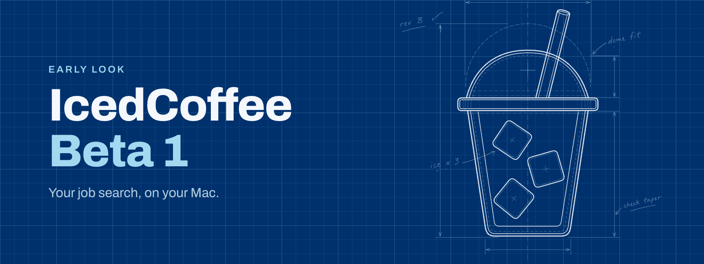

# IcedCoffee

IcedCoffee is a Mac app that keeps your resume, cover letters and job applications in one place.

## [Download IcedCoffee for Mac](https://github.com/qmanning/icedcoffee-releases/releases/latest)

Pick the DMG for your Mac (Apple silicon or Intel), drag IcedCoffee into Applications, and open it.

## What you need

- macOS 13 or later
- A Mac with Apple silicon or an Intel processor

## Your privacy

Your resume and job search stay on your Mac. Read the details at [icedcoffee.work/privacy](https://icedcoffee.work/privacy).

## Feedback

Use **Help > Send feedback** in the app, or email [feedback@icedcoffee.work](mailto:feedback@icedcoffee.work).
